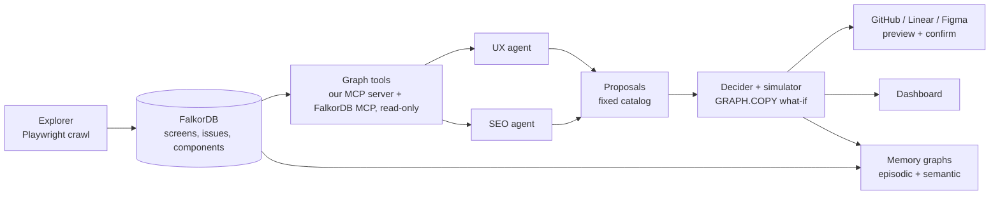

# Fens

**UX and SEO often want opposite things from the same page. Fens finds the conflict before you ship the fix.**

Fens crawls a running web app in a real browser and maps it as a graph in FalkorDB: screens are nodes, clicks are edges, and accessibility and SEO issues hang off the components that cause them. A UX agent and an SEO agent investigate that graph through tools and propose changes. A decider then tests every proposal on a throwaway copy of the graph, scores both lenses, and rules on it. Approved fixes leave as GitHub issues, Linear tickets and Figma comments, and the system remembers what it decided across releases.

> **The idea in one scene.** Sonakshi (UX) wants to cut a twelve-item menu to five. Divya (SEO) points out that seven pages would lose their links. They solve it in a second call: five items on top, a "Shop all" page, the full list in the footer. Fens reaches the same compromise in one pass, by simulating the change first.

**Note: A demo shop is the test target. The planted flaws in the testing website marked as fens-demo-shop shows the approach works.**

---

## How it works



1. **Crawl.** The explorer follows every link, clicks every button and runs axe-core, Lighthouse and our own SEO and AEO rules. Everything is written to FalkorDB.
2. **Investigate.** Two agents call graph tools (shortest path, PageRank, betweenness, communities, component fan-out, release diff) and cite the results as evidence. Each has a rules mode that needs no LLM.
3. **Propose.** Agents propose changes from a fixed catalog: table to cards, responsive table, content in HTML, remove links, add a link.
4. **Decide.** The decider copies the graph, applies the change to the copy, scores UX and SEO before and after, and deletes the copy. If neither lens gets worse, it approves. If one does, it looks for a reconciling playbook. If none works, it hands the case to a person.
5. **Act.** Decisions become work in the tools people already use, always behind a preview and a confirm step.
6. **Remember.** Each release is its own graph. Fens compares releases and keeps memory of runs, decisions and facts.

---

## What it finds (listing few of them here)

On the included test website (Fence, with planted flaws):

- The checkout forces **10 clicks** in v1, while a small "Buy now" link reaches confirmation in **3**. In v2 the forced path is 5.
- One low-contrast Sign in button is stored as **one issue** that fans out to every screen sharing the header.
- Three planted UX vs SEO conflicts: a wide table, an accordion whose answers need JavaScript, and a decluttered Home page. Two are reconciled by playbooks and one is approved outright.
- Removing a Home link looks harmless, but the simulator catches that it would orphan a product page.

---

## FalkorDB features used

### Graphs, copies and simulation
- **FalkorDB (Docker)** is the core datastore, and **FalkorDB Browser** (`http://localhost:3000`) lets you inspect screen topology, nodes and edges.
- **`GRAPH.COPY` and `GRAPH.DELETE`** power the decider. Each proposal is simulated on a temporary `sim-<id>` graph that is always deleted afterwards. One instance also holds a graph per release and per tenant.

### Graph algorithms as agent tools
- **PageRank** (`algo.pageRank`) ranks screens by importance. It decides which product links are safest to remove first.
- **Betweenness centrality** (`algo.betweenness`) finds bottlenecks that many paths depend on, such as cart and checkout steps.
- **Shortest path** (`shortestPath`) compares the ideal click path with the route the app forces.
- **Community detection** (`algo.labelPropagation`) groups screens into functional areas.

### Vector search
- **Vector index** (`db.idx.vector`) with cosine similarity over page text embeddings finds similar screens and flags pages under a mismatched menu category.

### Multi-hop reasoning
- One query can walk from a screen to its components, the design system component, the guideline it violates and the guidelines that conflict with it. That is how Fens traces a single component bug across many screens and exposes UX vs SEO trade-offs.

### Memory (all Cypher, no extra library)
- **Episodic memory** records every agent run, decision and release comparison.
- **Semantic memory** keeps current facts. A newer fact supersedes the older one and links back to it, so *SignInButton has a contrast issue* becomes *fixed in release two* with its history kept.
- **Procedural memory:** playbooks track success and fail counts, and the decider ranks them by success rate.
- Each tenant and user gets separate memory graphs. Agents hand work to each other through a handoff queue with atomic claims.

---

## Integrations

| Channel | What goes there | Notes |
|---|---|---|
| GitHub | Code fixes | Evidence, affected screens, selectors, before and after scores for both lenses |
| Linear | Content findings and decisions that need a human | Labels and priority from severity |
| Figma | A comment pinned to the exact element on the captured frame | Dry-run preview if no token or map |

All three share one payload and link to each other. Fens suggests an assignee based on who resolved similar issues, but never assigns anyone by itself. Nothing is created without a preview and an explicit confirm. When a later release fixes a finding, one action closes the loop in every channel, and it refuses while the problem is still present.

---

## Setup

Prerequisites: Docker, and Node.js 22.19 or newer (Lighthouse needs it).

```bash
# 1. Start FalkorDB and FalkorDB Browser
cd fens-api && docker compose up -d && cd ..

# 2. Install dependencies and create env files
for p in fens-api fens-dashboard fens-demo-shop fens-explorer; do
  (cd $p && npm install && cp .env.example .env)
done
(cd fens-explorer && npx playwright install chromium)

# 3. Serve both releases of the demo shop (separate terminals)
cd fens-demo-shop && npm run serve:v1   # port 5174
cd fens-demo-shop && npm run serve:v2   # port 5175

# 4. Crawl both releases into FalkorDB
cd fens-explorer
npm run crawl -- --graph demo-shop-v1 --url http://localhost:5174 --seed /orders --tasks tasks/demo-shop-v1.json --reset
npm run crawl -- --graph demo-shop-v2 --url http://localhost:5175 --tasks tasks/demo-shop-v2.json --reset

# 5. Start the API and the dashboard (separate terminals)
cd fens-api && npm run dev              # port 4000
cd fens-dashboard && npm run dev        # port 5173
```

Open `http://localhost:5173`. Everything works without an LLM key: choose **Rules only** or **Replay last run** in the Investigate panel.

---

## Environment variables

| Variable | Project | Required | Purpose |
|---|---|---|---|
| `FALKORDB_URL` | api, explorer | Yes | Defaults to `redis://localhost:6379` |
| `TARGET_URL` | explorer | Optional | Default crawl target |
| `ALLOWED_ORIGIN` | api | Yes | Dashboard origin for CORS |
| `VITE_API_URL` | dashboard | Yes | API address |
| `GEMINI_API_KEY`, `GEMINI_MODEL` | api | Optional | AI mode. Rules and replay modes work without it |
| `GITHUB_TOKEN`, `GITHUB_REPO` | api | Optional | Create and close GitHub issues |
| `LINEAR_API_KEY`, `LINEAR_TEAM_ID` | api | Optional | Create and complete Linear issues |
| `FIGMA_TOKEN`, `FIGMA_FILE_KEY` | api | Optional | Post Figma comments |

Missing credentials never break the app. The matching channel falls back to a dry-run preview.

---

## Limitations

- **Structure, not meaning.** Fens sees links, components and rendered text. It cannot judge whether the words on a page make sense to a person.
- **A demo shop is the test target.** The planted flaws show the approach works. They do not prove every real site behaves the same way.
- **AI mode depends on free-tier quotas.** Rules and replay modes exist so the demo never has to.
- **Lighthouse is slow.** It runs on one screen per page template, not on every screen.
- **Figma's free plan limits read calls**, so comments are posted from a saved frame map instead of reading the file live.
